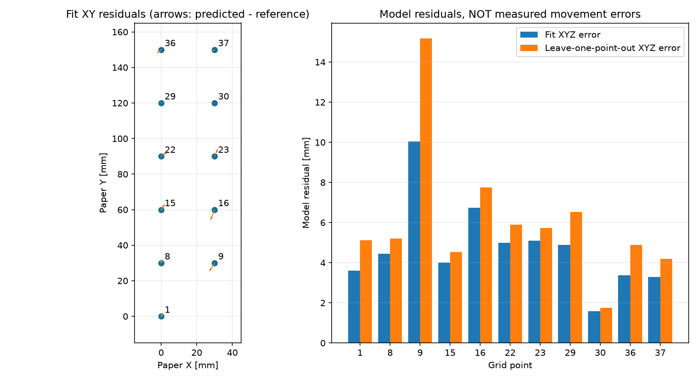

# 11点による実効運動学モデルの初期推定

2026年10月30日。ユーザー指定により、全11点を計算上Z=0の共通平面とし、手首は80度固定。元の観察記録（紙面のわずか上、高さ未測定）は維持する。教示・再生方式への切り替えは行わない。

## モデル

台座の回転と、同じ鉛直平面内の肩・肘2リンクを仮定する。手首80度・閉じたグリッパー150度での先端を扱い、固定工具の寄与を末端リンクの実効寸法に含める。肩と肘の方向4候補を比較し、上腕が上方へ向く制約の下で最も残差が小さい候補を採用。実機の全寸法を同定したモデルではない。

```text
a = s2 * shoulder_command + shoulder_offset
b = a + s3 * elbow_command + elbow_offset
r = L1*cos(a) + L2*cos(b)
theta = base_command + base_yaw
X = base_x + r*cos(theta)
Y = base_y + r*sin(theta)
Z = shoulder_height + L1*sin(a) + L2*sin(b)
```

式内の角度はラジアン。指令値をラジアンへ変換し、s2=-1、s3=+1を今回の候補として選択。各候補10初期値から境界付き最小二乗で計算（seed=42）。各点のXYZ残差を同じmm単位で最小化し、点の削除やRANSACは行わない。

## 結果

| 指標 | RMSE［mm］ | 最大［mm］ |
| --- | ---: | ---: |
| 11点への当てはまり | 5.17 | 10.03 |
| 1点ずつ除外して予測 | 6.87 | 15.18 |

除外予測では10点から同じモデルを再推定し、外した点の記録指令を入力してXYZを予測。モデル候補の選択には全11点を使用しているため、独立した最終評価ではなく探索的な診断。上記はモデル残差であり、指定位置へ実機を動かした誤差ではない。



| 点 | 当てはめ誤差［mm］ | 除外予測誤差［mm］ |
| ---: | ---: | ---: |
| 1 | 3.60 | 5.11 |
| 8 | 4.45 | 5.21 |
| 9 | 10.03 | 15.18 |
| 15 | 4.00 | 4.54 |
| 16 | 6.74 | 7.74 |
| 22 | 4.99 | 5.90 |
| 23 | 5.10 | 5.73 |
| 29 | 4.88 | 6.53 |
| 30 | 1.58 | 1.75 |
| 36 | 3.37 | 4.88 |
| 37 | 3.30 | 4.18 |

## 推定パラメータ（実測寸法ではない）

| パラメータ | 値 |
| --- | ---: |
| base_x_mm | -99.236573 |
| base_y_mm | 111.659723 |
| base_yaw_rad | -1.422086 |
| shoulder_height_mm | 15.000000 |
| effective_upper_length_mm | 75.546094 |
| effective_distal_length_mm | 83.521737 |
| shoulder_offset_rad | 3.172893 |
| elbow_offset_rad | 3.698116 |

ヤコビアンの数値階数は8/8、列正規化した条件数は約80.6。肩高さの推定値は下限15mmに接している。この境界値を実際の肩高さと解釈しない。範囲の狭さ、指令角の誤差、機構の仮定、Z=0近似などが推定値に影響する。高さ方向への一般化は未検証。

## 指定位置から角度を求める計算例

紙座標 (15,135,0)mm に対する連続角の解を丸めた候補は、台座・肩・肘の順で **[93, 144, 63]度**。手首は80度固定。

丸め後のモデル内の位置差は0.30mmだが、これは実機精度ではなく数値計算上の差。実機動作は実行していない。

位置候補は11点のXY凸包内に限定し、外挿を拒否する。通常の逆計算はZ=0のみ。3Dでの関節・工具・机との干渉、移動途中の経路、開いたグリッパーでの把持中心、高さ方向の予測は別に実機確認が必要。

## 保存と再計算

座標を指定して実機で1か所試す手順は [紙面座標テスト](arm_position_test_ja.md) を参照。

2026年10月31日、この1か所は高さを含めておおむね合っているとユーザー確認済み。次の実機試行は [スポンジの把持・搬送・解放](pick_place_first_trial_ja.md)。高さ15/40mmは未検証の候補。

- 計算モデルと元データのハッシュ：`runs/arm_kinematics/model.json`。
- 角度候補：`runs/arm_kinematics/preview_15_135_0.json`。
- 計算コード：`control/arm_kinematics.py`、実行：`vision/fit_arm_kinematics.py`。

```bash
.venv-ai/bin/python vision/fit_arm_kinematics.py
```

数式上の順運動学、逆計算の往復、外挿・未確認高さの拒否、合成データへの当てはめの4テストを確認。アームへの移動指令を送る機能はこの計算モジュールに含めない。

参考：[SciPy least_squares公式資料](https://docs.scipy.org/doc/scipy/reference/generated/scipy.optimize.least_squares.html)。
