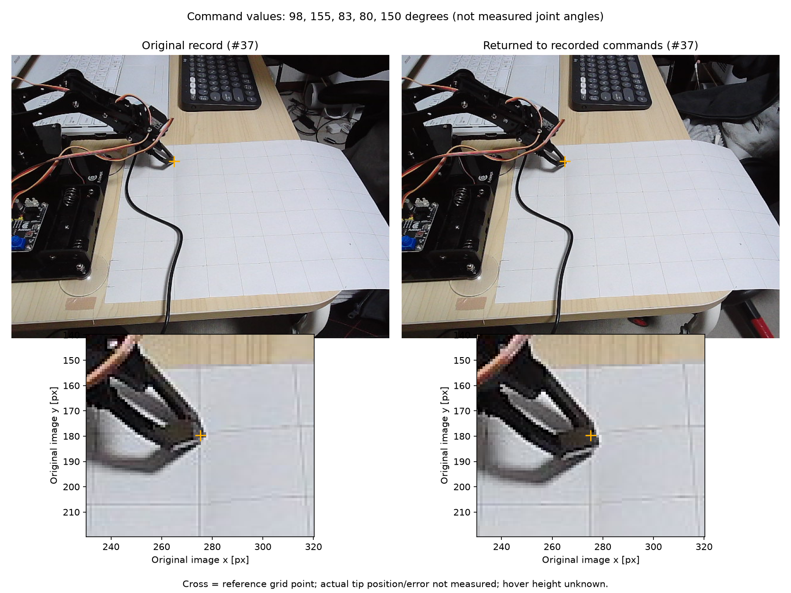

# 37番の姿勢再現テスト（2026年10月30日）

ユーザーが先端を格子へ合わせ直さず、保存した関節指令だけへ手動で戻した状態で撮影。撮影スクリプトから移動指令は送信していない。

| 台座 | 肩 | 肘 | 手首 | グリッパー |
| ---: | ---: | ---: | ---: | ---: |
| 98° | 155° | 83° | 80° | 150° |

撮影前後とも全5関節が有効で、指令値と目標値はこの組に一致。実際の関節角度は測定していない。

上段は全体、下段は同じ画素範囲の拡大。橙の十字は紙の37番（X=30,Y=150mm）の基準位置で、先端を自動検出した点ではない。

[元の写真](images/arm_reproducibility/20261030_point37/baseline_raw.png) / [今回の写真](images/arm_reproducibility/20261030_point37/raw.png)

## 現時点の確認結果

- 指令値の再現と、撮影中の指令値の一致を確認した。
- 写真では先端が元の位置付近へ戻っているように見える。小さなずれの有無や実距離は断定しない。
- 先端は机面のわずか上、接触なし。高さの実測値は不明。
- 実際の先端XYZ・位置誤差mmは未測定。1回の結果から繰り返し精度や全領域の精度を保証しない。
- 既知位置へ先端が合っていると確認した新しい校正点としては登録せず、再現テストとして別保存した。

元の校正記録：`runs/arm_calibration/20261030_221230_241932/230925_b47546bf/`。

今回の撮影・指令状態・比較画像：`runs/arm_reproducibility/20261030_231651_point37/`。

## 手動で同じ先端点を指定した比較結果

ユーザーが2枚それぞれで同じ先端点をクリック。2026年10月30日23:25 JSTに保存。

| 指標 | 結果 |
| --- | ---: |
| 画像上のずれ | 3.58px |
| 画像上の差（今回−元） | dx=+0.75px、dy=+3.50px |
| 紙面換算の見かけの差 | X=+0.5mm、Y=-3.9mm |
| 紙面換算の見かけの距離 | 約3.9mm |

机面付近の先端点を紙面へ投影した換算値。先端の高さ・高さ変化、手動クリック位置の誤差を含むため、真の3D位置誤差としては扱わない。これは元の記録と今回の差であり、37番の理想位置に対する誤差や複数回の繰り返し精度とは区別する。一度の比較結果を、そのまま全領域への一定補正量として適用しない。

