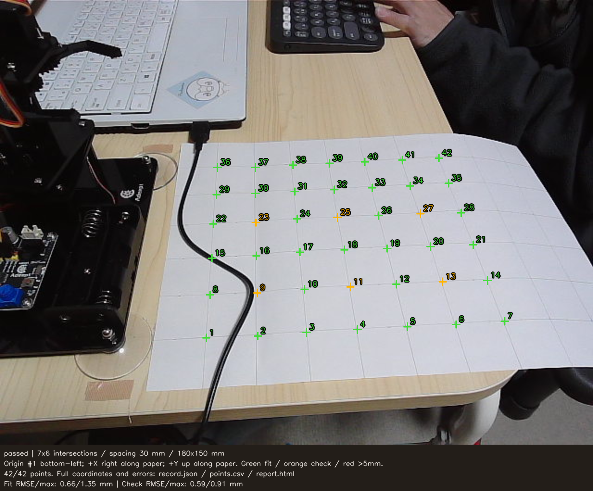

# 机面の座標校正結果（2026年10月30日）

30mm間隔の格子を使用。横7交点×縦6交点＝42点、範囲は横180×縦150mm。紙の左下を原点、紙に沿って右が+X、上が+Y。元画像は640×480px。

## 校正画像

緑：計算用36点。オレンジ：計算に使わない確認用6点（9・11・13・23・25・27番）。画像は確認しやすいよう2倍表示し、番号を重ねたもの。

[元画像を開く](images/calibration/20261030/grid_raw.png)

## 誤差の結果

| 用途 | 点数 | RMSE［mm］ | 最大誤差［mm］ |
| --- | ---: | ---: | ---: |
| 計算用 | 36 | 0.660 | 1.351 |
| 確認用 | 6 | 0.590 | 0.905 |

暫定の基準「計算用・確認用とも最大誤差5mm以下」に合格。最大誤差は24番の1.351mm。

この値は、格子の実寸が30mm間隔であると仮定した紙面上の整合性を表す。アームの位置決め精度や把持精度ではない。物体の高さ・レンズ歪みは未補正で、アーム台座との座標対応も未実施。

## 全42点の記録

| 番号 | 用途 | 画像座標 u,v［px］ | 基準座標 X,Y［mm］ | 変換結果 X,Y［mm］ | 誤差［mm］ |
| ---: | --- | --- | --- | --- | ---: |
| 1 | 計算用 | 222.67, 364.67 | 0, 0 | -0.14, 0.05 | 0.150 |
| 2 | 計算用 | 278.00, 362.67 | 30, 0 | 30.27, -0.63 | 0.689 |
| 3 | 計算用 | 330.67, 358.67 | 60, 0 | 59.44, -0.01 | 0.558 |
| 4 | 計算用 | 385.33, 355.33 | 90, 0 | 89.95, 0.14 | 0.147 |
| 5 | 計算用 | 439.33, 352.67 | 120, 0 | 120.24, -0.10 | 0.255 |
| 6 | 計算用 | 492.00, 350.00 | 150, 0 | 149.96, -0.29 | 0.290 |
| 7 | 計算用 | 544.67, 346.67 | 180, 0 | 180.03, -0.07 | 0.074 |
| 8 | 計算用 | 226.67, 318.00 | 0, 30 | 0.38, 30.18 | 0.422 |
| 9 | 確認用 | 277.33, 316.00 | 30, 30 | 30.24, 29.69 | 0.395 |
| 10 | 計算用 | 328.67, 312.00 | 60, 30 | 60.73, 30.56 | 0.925 |
| 11 | 確認用 | 378.00, 309.33 | 90, 30 | 90.23, 30.58 | 0.629 |
| 12 | 計算用 | 427.33, 306.67 | 120, 30 | 119.93, 30.61 | 0.612 |
| 13 | 確認用 | 477.33, 304.00 | 150, 30 | 150.22, 30.60 | 0.642 |
| 14 | 計算用 | 526.00, 302.67 | 180, 30 | 179.59, 29.71 | 0.507 |
| 15 | 計算用 | 228.67, 278.67 | 0, 60 | 0.02, 59.21 | 0.786 |
| 16 | 計算用 | 276.67, 276.00 | 30, 60 | 30.14, 59.39 | 0.625 |
| 17 | 計算用 | 323.33, 272.00 | 60, 60 | 59.71, 60.69 | 0.744 |
| 18 | 計算用 | 371.33, 269.33 | 90, 60 | 90.33, 60.87 | 0.931 |
| 19 | 計算用 | 417.33, 268.00 | 120, 60 | 119.68, 60.07 | 0.325 |
| 20 | 計算用 | 464.67, 266.00 | 150, 60 | 150.10, 59.74 | 0.276 |
| 21 | 計算用 | 510.67, 264.00 | 180, 60 | 179.83, 59.47 | 0.556 |
| 22 | 計算用 | 230.00, 241.33 | 0, 90 | -0.74, 90.50 | 0.890 |
| 23 | 確認用 | 276.00, 240.00 | 30, 90 | 30.00, 89.70 | 0.303 |
| 24 | 計算用 | 320.67, 236.00 | 60, 90 | 60.11, 91.35 | 1.351 |
| 25 | 確認用 | 364.00, 234.67 | 90, 90 | 89.38, 90.66 | 0.905 |
| 26 | 計算用 | 408.67, 232.67 | 120, 90 | 119.75, 90.51 | 0.569 |
| 27 | 確認用 | 453.33, 230.67 | 150, 90 | 150.28, 90.36 | 0.461 |
| 28 | 計算用 | 497.33, 229.33 | 180, 90 | 180.35, 89.64 | 0.501 |
| 29 | 計算用 | 233.33, 210.00 | 0, 120 | 0.11, 119.99 | 0.108 |
| 30 | 計算用 | 275.33, 208.67 | 30, 120 | 29.80, 119.37 | 0.656 |
| 31 | 計算用 | 318.00, 206.67 | 60, 120 | 60.11, 119.39 | 0.617 |
| 32 | 計算用 | 360.67, 204.67 | 90, 120 | 90.60, 119.41 | 0.837 |
| 33 | 計算用 | 401.33, 202.67 | 120, 120 | 119.83, 119.53 | 0.502 |
| 34 | 計算用 | 442.67, 200.67 | 150, 120 | 149.71, 119.61 | 0.485 |
| 35 | 計算用 | 484.00, 197.33 | 180, 120 | 180.15, 121.05 | 1.064 |
| 36 | 計算用 | 234.67, 180.67 | 0, 150 | -0.34, 150.97 | 1.028 |
| 37 | 計算用 | 275.33, 180.67 | 30, 150 | 30.05, 148.95 | 1.054 |
| 38 | 計算用 | 316.00, 178.00 | 60, 150 | 60.58, 149.90 | 0.585 |
| 39 | 計算用 | 355.33, 176.00 | 90, 150 | 90.28, 150.18 | 0.337 |
| 40 | 計算用 | 393.33, 174.67 | 120, 150 | 119.05, 149.78 | 0.978 |
| 41 | 計算用 | 434.00, 172.67 | 150, 150 | 150.09, 149.99 | 0.087 |
| 42 | 計算用 | 473.33, 170.67 | 180, 150 | 180.31, 150.28 | 0.416 |
