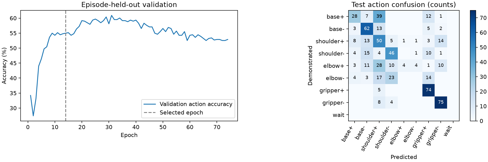

# 模倣学習の初回評価（2026年10月31日）

**学習・未使用試行での評価・実機への1°指令試行まで完了。搬送全体の自律成功は未確認。**

## データとモデル

- 成功27試行・4,534操作区間。保存画像をYOLO11nで処理し、全試行のfeatures.jsonを生成。
- 試行単位で学習19試行／検証4試行／テスト4試行。フレーム単位のランダム混合はしない。位置配置そのものの独立性は未確認。
- 入力15：スポンジ・coinの中心座標4、信頼度2、検出有無2、現在の指令角度4、手動段階3。内部クラスtargetは表示上のcoin。
- MLP：15→64 ReLU→64 ReLU→操作9クラス＋角度量1。手首は80°固定。パラメータ数5,834。
- 教師：台座±、肩±、肘±、グリッパー±、待機。角度量はabs(delta_deg)/4として回帰。
- 初回は単純な構成を基準にするため、小型MLPを採用。学習済み検出器を再利用でき、幾何計算を方策の入力に要求しない。

## 学習設定

- CPU 2スレッド、seed 42、batch 128、AdamW、学習率0.001、weight decay 0.001。
- 損失：CrossEntropy＋0.5×SmoothL1（角度量）。入力の標準化は学習データのみで計算。
- 上限300 epoch。検証損失が60 epoch改善しなければ停止。74 epochで停止、検証損失で14 epochの重みを採用。テスト結果で重みは選ばない。

## 結果

| 分割 | 試行 | 操作区間 | 操作一致率 | 最近傍の基準 | 角度量MAE |
| --- | ---: | ---: | ---: | ---: | ---: |
| train | 19 | 3315 | 61.1% | 100.0% | 0.61° |
| val | 4 | 573 | 55.0% | 47.8% | 0.59° |
| test | 4 | 646 | 52.5% | 47.4% | 0.68° |

学習分割の最近傍100%は自身を最近傍に含むためで、汎化の指標ではない。テストの多数派のみの基準は14.7%。角度量MAEは区間の操作量の誤差であり、実際の位置誤差や、誤った関節を選んだ場合も含めた制御誤差ではない。

テスト段階別の操作一致率：
- つかむまで：47.7%
- はなすまで：54.8%
- 退避：65.3%



操作一致率52.5%は搬送成功率ではない。肩と肘の選択を混同する傾向があり、特に肘操作の再現が弱い。現在の入力は1時点の検出特徴・指令値だけで、操作履歴・画像特徴・把持状態は入っていない。完全自動で長く動かす前に改善と検証が必要。待機の教師は学習分割にないため、モデルが自発的に停止や段階完了を判断するとは期待しない。

## 実機の最初の試行

- 記録：[20261031T112701_435973Z](../runs/imitation_bc/trials/20261031T112701_435973Z/record.json)
- 入力指令：[90, 110, 39, 80, 90]（台座・肩・肘・手首・グリップ）。
- 予測：base-、softmax値0.780、予測角度量2.56°。softmax値は校正済みの成功確率ではない。
- 初回は予測角度量をそのまま送らず、台座だけ−1°の指令を実行。台座の指令90°→89°を確認。他関節の指令値は保持。
- before.jpg・after.jpg・record.jsonを保存。実角度や先端座標を計測した試行ではなく、搬送全体の確認でもない。

## 実行・確認方法

再学習：

```bash
uv run python vision/train_imitation.py
```

画面：<http://127.0.0.1:8766> の「学習済みAIの試行」。段階を選んで「予測を確認」→表示を確認して「予測した方向に1°動かす」。段階切替は手動。初期の短い検証用で、連続自動搬送機能ではない。

[未使用試行の教師と予測を画像で比較（ローカル保管・Git管理外）](../runs/imitation_bc/viewer.html)。モデルはruns/imitation_bc/policy.pt、設定・分割・指標はreport.json、全予測はpredictions.json。

## リソース

- 今回の処理時間：195.7秒（再開後の未処理分の特徴抽出と学習・評価を含む）。以前の特徴抽出時間は含まない。
- CPU時間：345.2秒、平均CPU使用率換算：約176%（100%を1コア分とする）。
- プロセスのピークRSS：約393.3MiB。システム全体の使用量ではない。
- MLP単体の推論：約0.071ms／回（CPU、1000回平均）。カメラ・YOLO・通信・モーター動作時間は含まない。

49件の既存・追加テストを通過。予測だけでは動作しないこと、指令姿勢の変更や検出欠落時に実行を拒否すること、実行が1回1°で再利用できないことをテストした。

## 連続試行への更新

ユーザーの希望により、0.5未満で実行を拒否する条件を撤廃した。「最大予測で連続実行（長押し）」では、各1°操作の前に最新の画像検出・関節指令で再予測し、最大確率の操作を選ぶ。離す・画面外へ出る・フォーカスを失う・停止・段階変更で繰り返しを止める。送信済み1°は完了し得る。検出の鮮度・関節範囲・姿勢変更のチェックは継続する。段階の切替・終了判断は手動。これは評価の操作一致率が改善したことを意味しない。

## 台座が選ばれ続ける問題への更新

[台座目標の補助と比較結果](base_alignment_improvement_ja.md)を追加。元の行動モデルの予測を、成功例から学んだ台座目標で絞り込む。画面でオン・オフ可能。モデル単体の一致率や実機成功率が改善したと確認した状態ではない。

## 関節グループの順番固定

[操作順のルールと持ち上げ完了の確認](ai_motion_order_ja.md)を追加した。把持は台座→肩・肘、搬送は持ち上げ→台座→肩・肘。高さの完了判断は目視ボタンで行う。

元画像・操作ログ・全予測・試行写真はローカル保管（Git管理外）。重み・設定・評価要約・図はGitに保存する。データを含まないcloneだけでは学習の再実行はできず、別途ローカルデータが必要。
