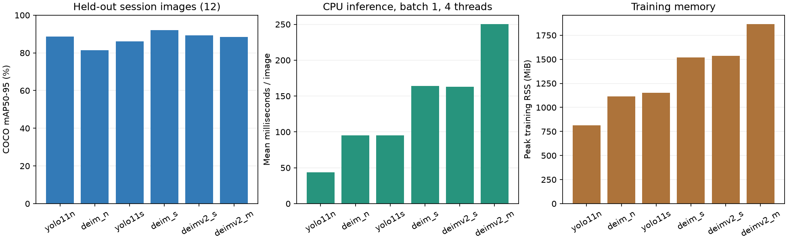
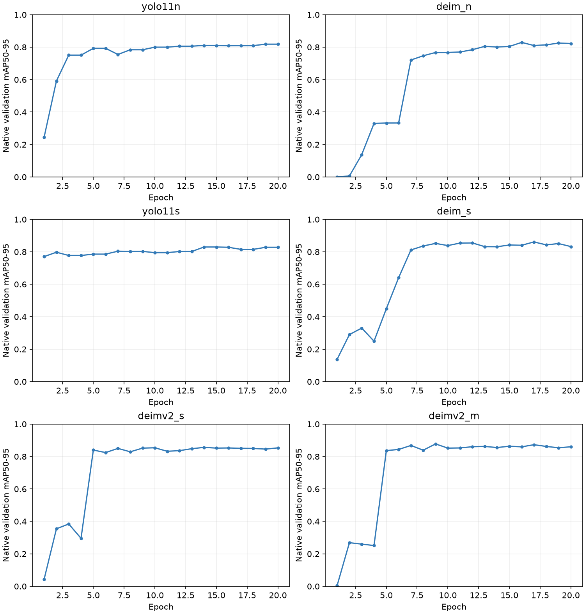

# 6モデルの物体検出評価報告書

2026年10月31日の整理で、稼働用YOLO11n以外の重みと中間チェックポイントを削除した。評価結果・設定・予測・画像ビューアは保持している。現在の保存範囲と再生成方法は [整理記録](repository_cleanup_20261031_ja.md) を参照。

実行日：2026年10月28日。新しい写真は追加せず、既存60枚だけを使用した。6モデルとも学習・検証・重み保存・最終評価まで完了している。

目的は、白いスポンジと黒い置き場所を固定カメラで検出するために、YOLO11n / YOLO11s、DEIM-D-FINE-N / S（v1）、DEIMv2-S / M（DINOv3系）の精度とCPU負荷を比較すること。実機を動かす評価や把持成功率の測定は含めない。

## 画像で確認する

[結果ビューア（ローカルHTML）](../runs/sponge_comparison/viewer.html)では、最終評価12枚・検証12枚を切り替えて、正解枠と6モデルの予測を確認できる。拡大・前後の画像への移動・正解枠の表示切替・誤検出や見落としのある画像だけへの絞り込みに対応。青が正解枠、緑が正しく検出した枠、橙が余計な検出または位置ずれ、赤の破線が基準を満たす検出のなかった正解枠。

```bash
xdg-open runs/sponge_comparison/viewer.html
```

画像と評価結果をHTML内に埋め込んでいるため、サーバー起動・インターネット接続・再推論は不要。再生成する場合は`uv run python vision/build_result_viewer.py`を実行する。[生成コード](../vision/build_result_viewer.py)と[画面テンプレート](../vision/result_viewer.html)はGit管理でき、写真を含む生成後のHTMLはruns内にローカル保存する。

## 結果

| モデル | 検証mAP50–95 | 評価mAP50–95 | 評価mAP50 | 両方検出 | 推論時間/枚 | 学習全体 | 最大RSS | 平均CPU |
| --- | ---: | ---: | ---: | ---: | ---: | ---: | ---: | ---: |
| yolo11n | 82.1% | 88.7% | 100.0% | 12/12 | 43.5 ms | 116.2秒 | 814 MiB | 377% |
| deim_n | 82.9% | 81.4% | 94.5% | 11/12 | 95.2 ms | 304.9秒 | 1113 MiB | 376% |
| yolo11s | 83.7% | 86.2% | 100.0% | 12/12 | 95.1 ms | 210.7秒 | 1151 MiB | 383% |
| deim_s | 86.1% | 92.0% | 100.0% | 12/12 | 164.0 ms | 552.1秒 | 1520 MiB | 380% |
| deimv2_s | 85.6% | 89.3% | 100.0% | 12/12 | 162.8 ms | 600.8秒 | 1534 MiB | 380% |
| deimv2_m | 87.8% | 88.5% | 99.7% | 12/12 | 250.2 ms | 822.8秒 | 1865 MiB | 382% |

検証用12枚でのmAP50–95が最も高かった候補は **deimv2_m**、検証時の推論時間が最も短かった候補は **yolo11n**。検証結果を基準にした候補であり、この小さなデータだけで普遍的な優劣は決めない。

ライブ認識の最初の実装候補は **yolo11n**。検証用12枚で両対象を検出し、confidence 0.25で余計な検出が0だった候補のうち、最も速かったため。モデルや閾値を最終評価画像に合わせて追加調整することはしていない。

推論時間はconfidence 0.25で、画像ファイルの読み込みを除き、前処理・モデル・後処理を含む。各モデルでウォームアップ3回後、12枚を3周、計36回計測。YOLOの自動融合とDEIM公式のdeploy変換を使用する。mAP用の予測は別にconfidence 0.001で取得する。カメラ取得・描画・アーム制御は含まない。CPU使用率は論理コア1個を100%とする。最大RSSは学習プロセスの最大常駐メモリで、PC全体の使用量ではない。

「両方検出」はconfidence 0.25以上かつ正しいクラス・IoU 0.5以上で両対象を検出した画像数。余計な検出もある場合を含むので、以下のTP/FP/FNも確認する。スコアの分布や校正はモデルごとに異なり、0.25は共通の初期運用条件で、各モデルの最適な閾値ではない。mAPは正解率とは異なり、検出枠の位置・スコア順位・見落としなどをまとめた指標。



## 検出の内訳

| モデル | 対象 | TP（正しい検出） | FP（余計な検出） | FN（見落とし） | Precision | Recall | 中心誤差平均 |
| --- | --- | ---: | ---: | ---: | ---: | ---: | ---: |
| yolo11n | sponge | 12 | 0 | 0 | 100.0% | 100.0% | 1.5 px |
| yolo11n | target | 12 | 0 | 0 | 100.0% | 100.0% | 1.1 px |
| deim_n | sponge | 11 | 2 | 1 | 84.6% | 91.7% | 2.1 px |
| deim_n | target | 12 | 3 | 0 | 80.0% | 100.0% | 1.1 px |
| yolo11s | sponge | 12 | 0 | 0 | 100.0% | 100.0% | 1.8 px |
| yolo11s | target | 12 | 0 | 0 | 100.0% | 100.0% | 1.1 px |
| deim_s | sponge | 12 | 2 | 0 | 85.7% | 100.0% | 1.3 px |
| deim_s | target | 12 | 1 | 0 | 92.3% | 100.0% | 1.0 px |
| deimv2_s | sponge | 12 | 0 | 0 | 100.0% | 100.0% | 1.5 px |
| deimv2_s | target | 12 | 1 | 0 | 92.3% | 100.0% | 1.3 px |
| deimv2_m | sponge | 12 | 0 | 0 | 100.0% | 100.0% | 1.4 px |
| deimv2_m | target | 12 | 2 | 0 | 85.7% | 100.0% | 1.3 px |

中心誤差は正しく検出できた対象だけの、元画像640×480上の枠中心の誤差。机上のmm単位の位置精度や把持成功率ではない。

比較画像の目視確認では、DEIM-Nにキーボードをスポンジとする余計な検出があった。また1枚ではスポンジの枠が手の方向まで大きく広がり、IoU 0.5に届かず、見落とし1件と余計な検出1件に数えられた。DEIM-Sには同じ対象への重複した枠があった。今回のconfidence 0.25の出力では、YOLO11n / 11sは最終評価12枚の両対象を検出し、余計な検出は0だった。閾値や後処理をこの評価結果に合わせて変更することはしていない。

## 実行環境

| 項目 | 内容 |
| --- | --- |
| OS | Ubuntu 26.04.1 LTS |
| CPU | Intel Core i7-8550U @ 1.80 GHz、4物理コア / 8論理コア |
| メモリ | OSから見える総容量 約30.21 GiB |
| 計算デバイス | 学習・検証・最終評価ともCPU。GPUは使用しない |
| Python / PyTorch / torchvision | 3.12.14 / 2.5.1+cpu / 0.20.1+cpu |
| Ultralytics / faster-coco-eval | 8.3.228 / 1.8.0 |
| NumPy / OpenCV / SciPy | 2.5.4 / opencv-python 4.14.0.94 / 1.18.1 |
| 実装の固定 | DEIM v1: `09d35d53d39ee3145a1e61e3a989b28b9468d1dd`、DEIMv2: `f005f50ce565e63f6c298feccb51901a98c3d035` |

## データセット仕様

元画像は固定Webカメラで撮影した640×480のJPEG。クラス0は白いスポンジ（sponge）、クラス1は黒い丸い置き場所（target）。各画像に各クラス1個ずつ、計120個の正解枠を付けた。対象がどちらも存在しない背景画像は含まれない。

| 分割 | 枚数 | sponge / targetの正解枠 | 用途 |
| --- | ---: | --- | --- |
| train | 36 | 36 / 36 | パラメータの更新 |
| val | 12 | 12 / 12 | 各モデルのbest重みの選択と候補比較 |
| test | 12 | 12 / 12 | 保存済みbest重みの最終評価 |

trainは撮影セッション`20261028_064150_737a`の6枚と`20261028_080953_3fb2`の30枚。val / testのセッションは後述の「条件と分割」に記載する。写真単位の無作為分割をせず、同じ撮影セッションが複数の分割へ入らないようにした。画像の完全一致重複・ラベルのクラス・枠の範囲を準備時に確認済み。写真やラベル自体は変更せず、別ディレクトリへコピーした。YOLO形式とCOCO形式は同じラベルから生成し、ファイル名・分割・SHA256を`manifest.json`に記録した。

## 学習設定の詳細

| 共通項目 | 設定 |
| --- | --- |
| 目的 | 公式COCO事前学習済み検出器を2クラスへ追加学習 |
| エポック数 / 入力 / バッチ | 20 / 320×320 / 2 |
| データ量 | 1エポック18バッチ、20エポックで360バッチ、延べ720画像提示 |
| seed / DataLoader workers | 42 / 0 |
| PyTorch CPUスレッド | 4。YOLOの内部上書きも4へ固定 |
| 数値精度 / AMP | float32 / 無効 |
| 検証とモデル保存 | 各エポックでvalを評価し、各実装の検証mAP50–95が最良の重みを選ぶ |
| 再開・凍結 | 前回の1エポック重みからのresumeは行わない。YOLO標準のDFL固定層はそのまま |
| 共通して無効化 | Mosaic、MixUp、ランダムな上下・左右反転、マルチスケール |

| 項目 | YOLO11n / YOLO11s | DEIM v1 N / S | DEIMv2 S / M |
| --- | --- | --- | --- |
| モデル構成 | YOLO11検出器 | DEIM-D-FINE + HGNetv2 B0 | DINOv3蒸留ViT-Tiny / TinyPlus + STA |
| 初期学習率 | 0.001 | backbone 0.00005、その他0.0002 | backbone 0.00005、その他0.0002 |
| Optimizer / betas | AdamW / (0.937, 0.999) | AdamW / (0.9, 0.999) | AdamW / (0.9, 0.999) |
| weight decay | 0.0005、bias / normのグループは0 | 0.0001、backbone以外のnorm / bn / biasは0 | v1と同じ |
| warmup | 設定2エポック、実装の下限100ステップにより約5.6エポック | 36ステップ（2エポック） | 36ステップ（2エポック） |
| 学習率スケジュール | cosine、最終比率lrf=0.1 | flat-cosine、flat_epoch=3、lr_gamma=0.1、no_aug_epoch=0 | v1と同じ |
| 勾配蓄積 | nbs=64により通常32バッチ。warmup中は1から32へ変化 | なし。各バッチで更新 | なし。各バッチで更新 |
| 勾配ノルム上限 | 10.0（実装既定） | 0.1 | 0.1 |
| EMA | 標準のEMAを使用 | 無効 | 無効 |
| リサイズ | 縦横比を保つletterbox | 320×320へ直接リサイズ | 320×320へ直接リサイズ |
| 画素値 | RGB float32、0〜1 | RGB float32、0〜1 | 0〜1変換後、mean=(0.485,0.456,0.406)、std=(0.229,0.224,0.225)で正規化 |
| 色・幾何の拡張 | hsv_h=0.015 / hsv_s=0.2 / hsv_v=0.2、translate=0.05、scale=0.1 | RandomPhotometricDistort p=0.5 | RandomPhotometricDistort p=0.5 |
| CopyBlend | 使用しない | 使用しない | 明示的に無効 |
| matcher切り替え | 該当しない | 追加の切り替えなし | epoch index 15（16周目）からIoU順序を使う公式のマッチングコストへ切り替え |

**同じ20エポック・バッチ2でも、YOLOとDEIM系では勾配更新回数が異なる。** 360バッチは360回のoptimizer更新を意味しない。学習率、EMA、損失関数、拡張、初期学習重みも異なるため、この実験は各設定での実用的な初期比較であり、アーキテクチャだけを統制した実験ではない。

| モデル | 実行時に保存した設定 | 評価に使う重み |
| --- | --- | --- |
| YOLO11n | [args.yaml](../runs/sponge_comparison/yolo11n/args.yaml) | `yolo11n/weights/best.pt` |
| YOLO11s | [args.yaml](../runs/sponge_comparison/yolo11s/args.yaml) | `yolo11s/weights/best.pt` |
| DEIM-N（v1） | [deim.yml](../runs/sponge_comparison/deim_n/deim.yml) | `deim_n/best_stg1.pth` |
| DEIM-S（v1） | [deim.yml](../runs/sponge_comparison/deim_s/deim.yml) | `deim_s/best_stg1.pth` |
| DEIMv2-S | [deim.yml](../runs/sponge_comparison/deimv2_s/deim.yml) | `deimv2_s/best_stg1.pth` |
| DEIMv2-M | [deim.yml](../runs/sponge_comparison/deimv2_m/deim.yml) | `deimv2_m/best_stg1.pth` |

重みの相対パスは`runs/sponge_comparison/`を基準とする。DEIM系の設定は公式YAMLを継承しており、上記ファイルは上書き項目を含む。継承元も固定コミットのコピーに保存している。

## 最終評価と計測の詳細

| 項目 | 設定・定義 |
| --- | --- |
| 評価画像 | test 12枚、各クラス12個、計24個。モデルの学習・best選択には使わない |
| 共通評価器 | faster-coco-eval 1.8.0、bbox、maxDets=[1,10,100] |
| mAP50–95 | IoU 0.50〜0.95を0.05刻みで平均し、2クラスで平均したAP。単純な正解率ではない |
| mAP50 | IoU 0.50での2クラス平均AP |
| mAP用の出力 | confidence 0.001以上、画像あたり上位100予測 |
| YOLOの後処理 | NMS IoU=0.7、max_det=100、class-aware、rect=Falseで320×320へletterbox |
| DEIM / DEIMv2の後処理 | 公式PostProcessorのスコア選択を使用。NMSは追加しない |
| TP / FP / FNの条件 | confidence≥0.25、同じクラスかつIoU≥0.5。スコアの高い順に正解枠へ1対1で対応付け、重複予測はFP |
| 中心誤差 | TPだけを対象に、元画像の予測枠中心と正解枠中心のユークリッド距離を平均（px） |
| 推論時間 | batch=1、CPU 4スレッド、confidence=0.25。精度用推論の後、追加のwarmup3回、12枚×3周の36回で平均・中央値・p95を保存 |
| 時間に含む処理 | メモリ上の画像の前処理、モデルforward、後処理、予測結果の取り出し |
| 時間に含まない処理 | モデル読み込み、画像ファイル読み込み、カメラ取得、画面描画、アーム制御 |
| 推論用の変換 | YOLOは標準の自動融合、DEIM / DEIMv2は公式model.deploy()。ONNX / OpenVINO / INT8は使用しない |
| 学習時間・CPU・最大RSS | /usr/bin/time -v。起動・モデル準備・学習・検証・保存を含み、ダウンロードやパッケージ導入は含まない |
| 時系列リソース | psutilで1秒ごとにプロセス群RSS、PC全体CPU率、利用可能メモリをCSVへ保存 |

学習時の検証はそれぞれの公式実装を使い、best重みの選択に用いる。その後、保存した重みを別プロセスで再ロードし、val / testの両方を共通の評価器で計算し直した。DEIM系の設定レジストリがモデル間で残らないよう、モデルごとにプロセスを分けた。既存4モデルの計測値は追加実験で再測定せず保存済み結果を利用したため、全モデルを同一時刻のPC負荷で測ったものではない。

## 条件と分割

- 学習36枚・検証12枚・最終評価12枚。撮影セッションをまたがって同じセッションを分割しない。元画像とラベルは変更しない。
- 検証：`20261028_073737_b805`（12枚）。最終評価：`20261028_075220_c639`（11枚）と`20261028_063549_09d5`（1枚）。残り2セッションを学習用にした。
- 全モデルを公式COCO事前学習重みから改めて20エポック追加学習。前回の1エポックの重みは再利用しない。
- CPU、4スレッド、入力320×320、バッチ2、seed 42。各モデル内で検証mAP50–95が最もよい重みを保存し、それを最終評価した。
- 最終評価は共通のfaster-coco-eval、maxDets=100で計算。モデル本来の後処理を使用（YOLOはNMS、DEIMはクエリのスコア選択）。低スコアの予測もmAP計算に使う。
- YOLOは縦横比を保つletterbox、DEIMはリサイズ。YOLOは標準のEMAを使用し、DEIMは前回の動作確認から継続してuse_ema=falseとした。学習率・データ拡張・損失関数も異なるため、アーキテクチャだけの厳密な比較ではなく、この設定での初期比較。各モデルのハイパーパラメータ最適化は行っていない。
- YOLO：AdamW、初期学習率0.001、warmup_epochs=2とcosine減衰（この実装の下限100ステップにより、このデータではwarmupは約5.6エポック）、軽い色・位置・拡大縮小の変化。DEIM：AdamW、backbone 0.00005／その他0.0002、36ステップwarmup、軽い色変化。いずれもMosaicとMixUpは無効。
- DEIMv2-S / Mを後から追加。公式モデル一覧のDINOv3系構成（S: ViT-Tiny＋STA、M: ViT-TinyPlus＋STA）を使用し、HGNetv2系の同名サイズと混同しない。公式COCO検出器の全体重みを読み込み、2クラスへ追加学習した。
- DEIMv2は公式設定に従いImageNet mean/stdで画像を正規化する。Mosaic / MixUp / CopyBlendは無効、EMAなし。学習率と20エポックの条件はDEIM v1と共通とし、v2のmatcher切り替えは短い学習に合わせてepoch index 15（16周目）に設定した。
- 追加比較では既存4モデルの重み・評価結果を保存し、そのまま再利用した。DEIMv2を追加する前に既存モデルの評価結果は既に確認済みなので、6モデルの比較は探索的な追加実験として扱う。新規の独立した評価データは増やしていない。
- 再学習結果を今回の評価画像を見て調整することはしていない。ただしこの60枚の一部は前回の動作テストにも使用済みで、完全に新規撮影した未知環境の評価ではない。



学習曲線はそれぞれの実装内の検証指標。上の比較表は保存済みモデルを共通の評価器で計算し直した値なので、小さな差がある場合がある。

## このモデルを選んだ理由

- YOLO11n：CPUで最初の学習と推論を確かめるため、軽いNano版を出発点にした。Ultralyticsの学習・推論・保存のAPIがそろい、既存のYOLO形式ラベルも使えるため、短期間の試作へ組み込みやすい。
- DEIM-D-FINE-N / S：最初に比較したDEIM v1。DETR系の小さい構成を選び、CPU負荷を先に確かめた。DEIMv2とは別の実装と重みを使用している。
- DEIMv2-S / M：ユーザーの追加依頼で、DINOv3の特徴を利用する公式S/M構成を比較。v1との違いと、サイズによる精度・CPU負荷の変化を調べるため。
- YOLO11s／DEIM-D-FINE-S：Nano版の実測メモリに余裕があったため、一段大きいSmall版で精度と処理時間の変化を確かめた。大きいほどこの60枚でよい結果になるとは限らない。
- COCO事前学習重み：60枚でゼロから特徴抽出まで学ぶより、一般的な画像特徴を引き継いで2クラスへ適応させる出発点として選んだ。
- YOLO11とDEIM v1は最新であることを理由に選んだものではない。前回動作確認済みの構成を継続し、サイズによる変化を確認した。

参考：[YOLO11公式](https://docs.ultralytics.com/models/yolo11/)、[DEIM v1公式とモデル一覧](https://github.com/Intellindust-AI-Lab/DEIM)、[DEIMv2公式とモデル一覧](https://github.com/Intellindust-AI-Lab/DEIMv2)。

## 限界と次の判断

評価は各クラス12個、同じ机・固定カメラ・同じ物体に限られる。1個の見落としでRecallは約8.3ポイント変わる。対象がない背景の画像や、照明・カメラ位置・別の物体への一般化は確認できない。単一seed・20エポックの比較なので、モデル固有の性能差と断定しない。検出枠が良くても、座標校正や把持制御が成功することは別途確認する必要がある。

## コード・設定・出力

- [実験設定](../configs/vision_experiment.json)、[学習コード](../vision/train_detector.py)、[実行とリソース記録](../vision/run_experiments.py)、[共通評価](../vision/evaluate_detectors.py)、[集計](../vision/summarize_experiments.py)。
- データ：`data/sponge_evaluation/`。分割とハッシュは`manifest.json`。
- 重み：`runs/sponge_comparison/<モデル>/weights/best.pt`（YOLO）、`best_stg1.pth`（DEIM）。
- 学習ログ：`<モデル>.log`、時間・CPU・最大RSS：`<モデル>_time.txt`、1秒ごとのプロセス群RSS／PC全体CPU／空きメモリ：`<モデル>_resources.csv`。
- 共通評価の結果：`val_evaluation.json`、`test_evaluation.json`、`summary.json`。各モデルの予測枠と画像は`val_predictions.json` / `test_predictions.json`と`val_images/` / `test_images/`。
- 画像比較：`runs/sponge_comparison/test_comparison.jpg`（代表3枚、正解枠＋6モデル。見落とし・余計な検出のある例を優先して含める）。データ・重み・個別画像・ログはGit対象外。

```bash
uv run python vision/run_experiments.py
uv run python vision/evaluate_detectors.py --split val
uv run python vision/evaluate_detectors.py --split test
uv run python vision/summarize_experiments.py
```

実行済みの学習は再実行時にスキップする。新しい条件で学習する際は設定ファイルのoutputを新しいフォルダへ変え、評価用画像を見た後の調整は別の実験として扱う。

データの準備コマンド（出力先が既にある場合は再実行不要）：

```bash
uv run python vision/prepare_training_test.py --output data/sponge_evaluation --val-session 20261028_073737_b805 --test-sessions 20261028_075220_c639 20261028_063549_09d5
```

環境構築は[最初の動作テスト](training_test_ja.md)を参照。追加モデルは`models/yolo11s.pt`と`models/deim_dfine_s_coco.pth`に公式重みを配置する。配布元：[YOLO11s](https://github.com/ultralytics/assets/releases/download/v8.3.0/yolo11s.pt)、[DEIM-S](https://drive.google.com/file/d/1tB8gVJNrfb6dhFvoHJECKOF5VpkthhfC/view)。DEIM公式コピーのコミットと重みのSHA256、Pythonと依存パッケージのバージョンは`runs/sponge_comparison/environment.json` / `environment.txt`へ記録した。

DEIMv2の追加取得：

```bash
git clone https://github.com/Intellindust-AI-Lab/DEIMv2.git reference/DEIMv2
git -C reference/DEIMv2 checkout f005f50ce565e63f6c298feccb51901a98c3d035
```

公式重みは[DEIMv2-S](https://drive.google.com/file/d/1MDOh8UXD39DNSew6rDzGFp1tAVpSGJdL/view)を`models/deimv2_dinov3_s_coco.pth`、[DEIMv2-M](https://drive.google.com/file/d/1nPKDHrotusQ748O1cQXJfi5wdShq6bKp/view)を`models/deimv2_dinov3_m_coco.pth`へ配置する。今回は既存のPython環境で公式requirementsのPyTorch 2.5.1 / torchvision 0.20.1を満たしており、追加依存のインストールは不要だった。追加実験の設定・公式コピーのコミット・配布重みのSHA256は`runs/sponge_comparison/deimv2_environment.json`へ記録した。
