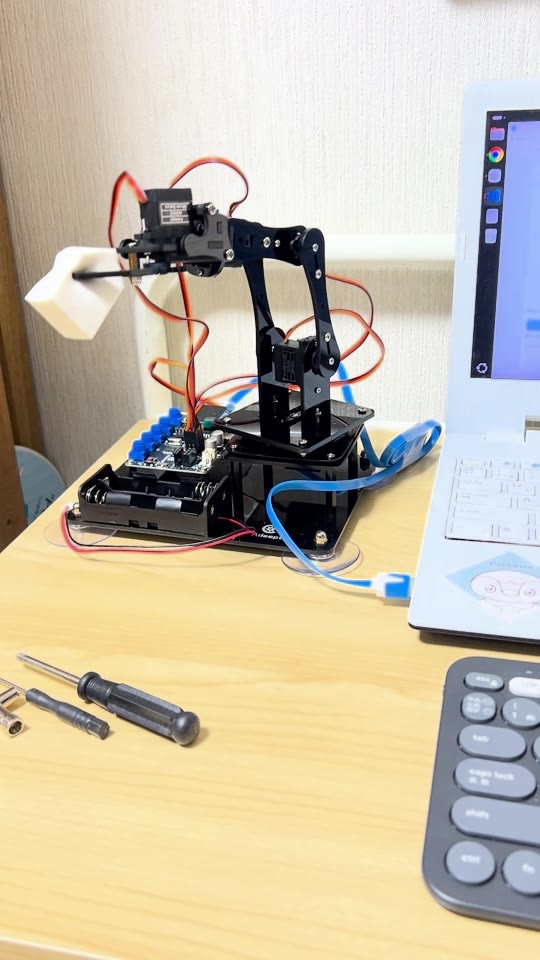

# 初回のブロック搬送デモ

撮影日：2026年10月25日。手動操作で白いブロックをつかみ、持ち上げて搬送し、机上へ置く実機記録です。自律認識・自動搬送のデモではありません。

- [再生用MP4](20261025_arm_demo_compatible.mp4)
- [約5秒間隔のコマ画像一覧](20261025_arm_demo_storyboard.jpg)

元動画はプロジェクト直下の `IMG_2769.MOV` に変更せず残しています。元の形式はiPhoneのHEVC Main 10 / HDR（HLG）、約1分59.85秒、音声付き。Git対象からは除外しています。

再生用はH.264 / yuv420p / AACのMP4です。縦向きを維持して720×1280へ縮小し、HDRからSDRへ変換しています。Web再生向けにfaststartを設定し、撮影メタデータは転記していません。

## コマ画像で確認した内容

- 約30〜45秒：白いブロックへ接近し、把持して持ち上げる。
- 約45〜80秒：物体を保持したまま台座や腕の姿勢を変えて搬送する。
- 約80〜100秒：机上へ置き、指を開いて解放する。
- 終盤：ブロックを机上に残し、アームを戻す。

時刻は約5秒ごとに抽出した画像による概算です。連続動画からの速度・温度・関節角度の実測評価は行っていません。
